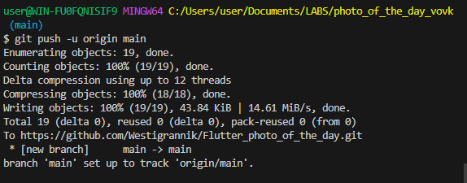

# Лабораторная №8
## В этой лабораторной мы изучили FUTURE, а также делали сайт, который показывает рандомные фото
___
## Вовк Тимофей ИСП-242

**Flutter**: 3.47.6
**Dart**: 3.13.5
**Browser**: Brave
**Пакет**: http

## Запуск
1. `git clone <https://github.com/Westigrannik/Flutter_photo_of_the_day>`
2. `cd photo_of_the_day`
3. `flutter pub get`
4. `flutter run -d chrom

## Что изучили
1. Что такое Future
2. Как пользоваться Future
3. подробней изучили как работать с классами

## Ответы на вопросы

1. Future<T> это возращаемый объект, который позволяет вернуть объект ПОТОМ.
2. await завершает Future, при этом не блокируя поток
3. Чтобы управлять состоянием во время загрузки
4. Потому что это является ссылкой на функцию
5. Тем, что image.network берёз картинку из сети, когда image.asset() из файлов на компьютере.